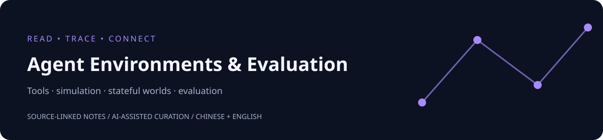

<p align="center"><a href="README.md">English</a> | <strong>简体中文</strong></p>

<p align="center"><a href="https://ppchanning.github.io/agent-environments-and-evaluation/index.zh-CN.html">阅读网站</a> · <a href="agent-index.zh-CN.md">Agent index</a> · <a href="llms.txt">llms.txt</a> · <a href="https://www.selfref.org/agents/curated-zh.html">SelfRef 资源库</a></p>

<p align="center"></p>

<h1 align="center">Agent Simulation Environments</h1>
<p align="center"><strong>Agent 仿真环境：构建、生成与可信验证的研究地图</strong><br>Explore how interactive worlds are simulated, generated, and validated for AI agents.</p>

<p align="center">
  <a href="LICENSE"></a>
  <a href="topics/README.md"></a>
  <a href="README.md"></a>
</p>

<p align="center"><a href="#updates">更新记录</a> · <a href="#start-here">快速开始</a> · <a href="#explore-the-landscape">主题地图</a> · <a href="#selected-reading">代表资料</a> · <a href="resources/papers.md">完整书目</a> · <a href="digests/README.md">晨读归档</a> · <a href="CONTRIBUTING.md">参与贡献</a></p>

**为 Agent 寻找可交互、可扩展、可验证的仿真环境。**

本仓库聚焦 **Agent 仿真环境（Agent Simulation Environments）**：把软件系统、工具服务和任务世界中的状态、动作、观察、反馈与状态转移机制，组织为 Agent 可以反复交互的模拟世界。研究主线是这些世界如何构建、如何自动生成、如何保持行为一致性，以及训练和测试结果在什么条件下能迁移到真实系统。

这里汇集有状态软件模拟器、API / 工具服务仿真、浏览器与终端任务环境、轨迹驱动仿真、语言世界模型及可验证环境生成等方向的论文与技术阅读材料。工具协议用于理解仿真的交互接口；状态验证、反事实轨迹和执行评测用于判断模拟世界及其反馈是否可信。

读者可以据此选择环境设计方案、比较程序化与模型驱动仿真的适用条件、寻找状态和行为验证方法，并建立自己的仿真研究文献表。论文笔记保留问题、方法、作者证据、限制和原始出处，帮助判断一个模拟器能支持哪些研究结论。

## Updates

<!-- updates-daily:start -->
- **2026-10-18** — 新增[5项研究资料、1期晨读](digests/agent-environments/2026/2026-10-18.md)：服务仿真、网站副本与实验室持久状态；分别说明执行回滚与裁判一致性的边界。
- **2026-10-17** — 新增[5篇论文、1期晨读](digests/agent-environments/2026/2026-10-17.md)：有状态服务模型、轨迹测试与仿真到现实的预测。含本次新入库的较早论文。
- **2026-10-16** — 新增 [5 篇论文、1期晨读](digests/agent-environments/2026/2026-10-16.md)：共享状态环境、工具仿真与模拟器保真；本次书目新增包含较早发表的研究。
- **2026-10-15** — 新增 [5 篇论文、1期晨读](digests/agent-environments/2026/2026-10-15.md)：规则本世界模型、可执行工具环境与失败风险模拟；保留测试证据的适用边界。
- **2026-10-14** — 新增 [5 篇论文、1 期晨读](digests/agent-environments/2026/2026-10-14.md)：终端环境生成、历史世界重放与失败诊断；真实 API 测试提供仿真验证参照。
- **2026-10-13** — 新增 [5 篇论文、1 期晨读](digests/agent-environments/2026/2026-10-13.md)：云模拟器生成、保真与黑盒行为核查；真实服务测试提供验证参照。
- **2026-10-12** — 新增 [5 篇论文、1 期晨读](digests/agent-environments/2026/2026-10-12.md)：仿真反馈、API 依赖与不稳定测试。 同日上线 [3 篇双语指南](guides/simulation-environment-selection.zh-CN.md)、[1 个 Agent 索引](agent-index.zh-CN.md)、[1 个 Skill](skills/agent-simulation-selection/SKILL.md)与 Pages 阅读站；收录到 2 个 Skill 目录，接入 [SelfRef 资料库](https://www.selfref.org/agents/curated-zh.html)。
<!-- updates-daily:end -->

首页保留最近 7 天；[查看完整记录](CHANGELOG.zh-CN.md)。 过往记录按资料日期回溯，于 **2026-10-10** 仓库上线时补入，非历史发布记录。

<!-- updates-milestones:start -->
- 📚 **2026-10-12** — [SelfRef 资源库](https://www.selfref.org/agents/curated-zh.html)上线：统一检索两仓库，提供 6 篇双语指南与 2 个 Skill 下载。
- 🧭 **2026-10-12** — [3 篇核心指南与 Agent 阅读入口](agent-index.zh-CN.md)，完整中英文版本和 [公开阅读站](https://ppchanning.github.io/agent-environments-and-evaluation/index.zh-CN.html)。
- 🚀 **2026-10-10** — [仓库上线](https://github.com/ppchanning/agent-environments-and-evaluation/commit/af1062e)：整理 [43 项资料](resources/papers.md)、[4 条仿真阅读路径](topics/README.md)，提供[中英文首页](README.md)与[更新记录](CHANGELOG.zh-CN.md)。
<!-- updates-milestones:end -->

## 核心指南与 Agent 入口

3 篇核心指南均有完整中英文版本，提供原始来源、适用边界和可复用模板。

| 指南 | 内容 |
| --- | --- |
| [如何选择 Agent 仿真环境](guides/simulation-environment-selection.zh-CN.md) | 按任务所需行为，比较有状态模拟器、工具镜像、生成环境与学习型世界。 |
| [如何生成可验证的 Agent 仿真环境](guides/environment-generation.zh-CN.md) | 从任务规范走到可执行状态、重置、验证器和留出验证的设计流程。 |
| [如何验证 Agent 模拟器的状态与行为保真度](guides/simulation-fidelity.zh-CN.md) | 检查转移、副作用、反事实轨迹、任务成功与迁移结论的实用验证矩阵。 |

[阅读网站](https://ppchanning.github.io/agent-environments-and-evaluation/index.zh-CN.html) · [Agent 索引](agent-index.zh-CN.md) · [JSON manifest](agent-index.json) · [llms.txt](llms.txt)

## 可安装的 Agent Skill

[查看 Skill](skills/agent-simulation-selection/SKILL.md)：把指南、JSON 证据和原始来源串成可执行的研究流程。示例：选择有状态仿真环境，并设计隐藏副作用与重置检查。

```sh
npx skills add ppchanning/agent-environments-and-evaluation --skill agent-simulation-selection
```

通过 Skills CLI 安装到支持的 Agent；首次运行会获取 CLI。Skill 本身是只读研究流程，输出包含依据、未知项和下一步核验。平台目录的收录状态与安装能力分别核实。

在 [Agent Skill Hub](https://agentskillhub.dev/u/ppchanning/sk/agent-simulation-selection) 和 [askill](https://askill.sh/skills/gh/ppchanning/agent-environments-and-evaluation/@agent-simulation-selection) 查找这个 Skill。[DeepWiki](https://deepwiki.com/ppchanning/agent-environments-and-evaluation) 提供仓库导览和问答；其生成说明仍需对照引用的源文件核查。

## Start here

| 你想解决什么问题 | 阅读入口 | 可以获得什么 |
| --- | --- | --- |
| 如何构建或自动生成 Agent 仿真环境？ | [仿真环境构建与生成](topics/environment-generation.md) | 有状态模拟器、程序化生成、轨迹驱动仿真与语言世界模型的研究线索 |
| 仿真是否保持了真实系统的状态和行为？ | [状态与行为验证](topics/state-and-testing.md) | 状态转移、隐藏动态、行为一致性与验证方法 |
| 如何模拟 Agent 使用的工具和服务？ | [工具接口与服务仿真](topics/tool-protocols.md) | MCP / API 接口、工具反馈与有状态服务行为的阅读路径 |
| 如何评价仿真质量及其中的 Agent 执行？ | [仿真可信度与执行评测](topics/agent-evaluation.md) | 仿真保真度、轨迹检查、结果验证和迁移限制的比较思路 |
| 最近有哪些值得关注的仿真研究？ | [最新晨读](digests/agent-environments/2026/2026-10-18.md) · [历史归档](digests/README.md) | 每期推荐、方法解读、证据限制和原始来源 |
| 如何整理自己的相关工作表？ | [完整书目](resources/papers.md) · [JSON 数据](data/README.md) | 去重标识、来源、版本与出现记录，便于筛选和继续阅读 |

适合构建 Agent 训练与测试环境的研究者、软件及工具服务模拟器开发者、世界模型与合成环境研究者，以及需要验证仿真状态和行为的系统开发者。首页提供[英文](README.md)与简体中文两个版本；阅读笔记和配套指南目前主要使用中文，保留英文题名与原始出处。

## Explore the landscape

### Simulation design & environment generation · 仿真环境构建与生成

研究如何把软件、工具服务和任务流程变成可交互的模拟世界。覆盖有状态模拟器、自动生成环境、轨迹驱动仿真和语言世界模型，比较环境初始化、状态转移、任务生成与反馈机制，以及规模扩展与行为保真度之间的取舍。

**阅读入口：** [Simulation design & environment generation](topics/environment-generation.md)

### State & behavioral fidelity · 状态与行为保真

仿真质量需要检查动作序列是否产生合理的状态变化、隐藏动态是否一致、错误条件是否被保留，以及长交互中是否出现行为漂移。该主题整理状态检查、差分测试、反事实轨迹与行为验证的研究线索。

**阅读入口：** [State & behavioral verification](topics/state-and-testing.md)

### Tool interfaces & service simulation · 工具接口与服务仿真

MCP / API 协议定义 Agent 与环境交互的接口，模拟器还需要实现接口背后的状态与服务行为。该主题关注工具调用、服务反馈、接口测试和真实 API 的模拟，支持理解和验证仿真环境的交互层。

**阅读入口：** [Tool interfaces & service simulation](topics/tool-protocols.md)

### Simulation validity & execution evaluation · 仿真可信度与执行评测

结合执行轨迹、任务结果、过程指标和真实系统对照，判断仿真反馈是否可靠、其中测得的 Agent 能力适用于什么范围。关注保真度、可复现性、环境偏差与迁移条件，并保留支持这些判断的原始证据。

**阅读入口：** [Simulation validity & execution evaluation](topics/agent-evaluation.md)

## Selected reading

下面围绕仿真环境的构建、生成和验证展示代表资料。题目链接指向原始来源，中文问题是本集合的阅读切入点；完整元数据与关联晨读见 [Paper Catalog](resources/papers.md)。

| 阅读问题 | 代表资料 | 关联主题 |
| --- | --- | --- |
| 交互轨迹如何变成可执行的模拟世界？ | [From Traces to Agentic Worlds](https://arxiv.org/abs/2610.06100) | 环境生成、世界模型 |
| 如何自动生成带验证机制的技能训练环境？ | [SkillGym](https://arxiv.org/abs/2609.37539) | 环境生成、工具使用 |
| 有状态的软件模拟器怎样接受行为检查？ | [CTE-Bench](https://arxiv.org/abs/2609.36647) | 仿真、状态、评测 |
| Agent 宣称完成后，应该检查什么系统证据？ | [The Agent Said It Was Done. The Database Disagreed.](https://huggingface.co/blog/microsoft/thinkingbox) | 任务验证、真实状态 |
| 如何模拟真实 API 的交互行为？ | [StableToolBench-MirrorAPI](https://aclanthology.org/2025.findings-acl.273/) | 工具服务仿真、API 环境 |

## What a reading note gives you

每期围绕以下问题组织内容，具体深度取决于可访问的原始证据：

- **问题与场景：** 研究模拟哪类系统、工具或任务，为什么需要仿真，真实参照是什么。
- **方法与系统：** 仿真如何表示状态、动作、观察与反馈，环境如何生成和更新，关键机制在哪里。
- **作者证据：** 使用哪些轨迹、任务、真实系统对照或验证机制，结果支持什么范围的仿真质量与 Agent 能力结论。
- **限制与迁移条件：** 模拟与真实执行的差距、未覆盖的行为，以及理解结果需要保留的条件。
- **继续阅读：** 原论文链接、版本信息及适合优先阅读的章节。

主题目录支持横向比较，日期归档支持持续跟踪，结构化书目支持本地检索。它们共同帮助读者建立自己的相关工作和方法地图。

## Collection at a glance

<!-- collection-stats:start -->
截至 **2026-10-18**：**19 期晨读 · 83 项去重资料 · 4 条专题阅读路径**。

晨读归档覆盖 2026-09-28 至 2026-10-18，日期范围内可能有缺期。新增与修订材料按日期归档，最新入口、主题索引和去重书目一起维护。
<!-- collection-stats:end -->

## How to use this repository

1. **首次进入：** 选一个实际问题，从对应主题页挑选论文，再结合晨读找到阅读重点。
2. **持续跟踪：** 阅读最新一期，通过历史归档回看同一方向的方法变化。
3. **设计仿真环境：** 比较不同工作中的状态、动作、反馈、环境生成和保真度验证机制；回到原文确认适用条件。
4. **整理相关工作：** 下载 [papers.json](data/papers.json)，按标识、版本和出现记录去重，建立自己的文献表。可选字段可能缺失，详见 [Data Guide](data/README.md)。
5. **贡献资料：** 推荐有来源的论文或技术案例，改进主题归类和元数据，或提交证据纠错。见 [贡献指南](CONTRIBUTING.md) 与 [Issues](https://github.com/ppchanning/agent-environments-and-evaluation/issues)。

## Repository map

```text
digests/       # 论文晨读：频道 / 年份 / 日期
topics/        # 仿真构建与生成、状态保真、服务仿真与执行验证
resources/     # 完整书目与原始来源入口
data/          # 去重 JSON 书目与字段说明
docs/          # 编辑标准、分享说明与设计参考
templates/     # 新增资料的统一模板
.github/       # 推荐资料、纠错与 Pull Request 模板
```

## Sources, contributions & citation

这是论文与技术资料集合，提供阅读和比较系统设计所需的材料。可执行环境、基准实现或评测结果以各原始项目为准。整理区分预印本、正式论文及官方案例，保留来源、版本和证据限制；内容由 AI 辅助整理，不推断维护者已读完或独立复现。详见 [Editorial Policy](docs/editorial-policy.md)。

欢迎补充论文、技术案例、阅读路径与纠错，见 [CONTRIBUTING](CONTRIBUTING.md)。原创说明与汇编采用 [CC BY 4.0](LICENSE)，第三方作品保留各自权利。科研结论请引用原论文；引用本集合可使用 [CITATION.cff](CITATION.cff)。

**Related collection:** [AI4Science Observatory](https://github.com/ppchanning/ai4science-observatory) 聚焦 AI 科学发现、科研智能体、科学软件和远程真实实验。

[分享说明](docs/sharing.md) · [设计参考](docs/design-references.md)
